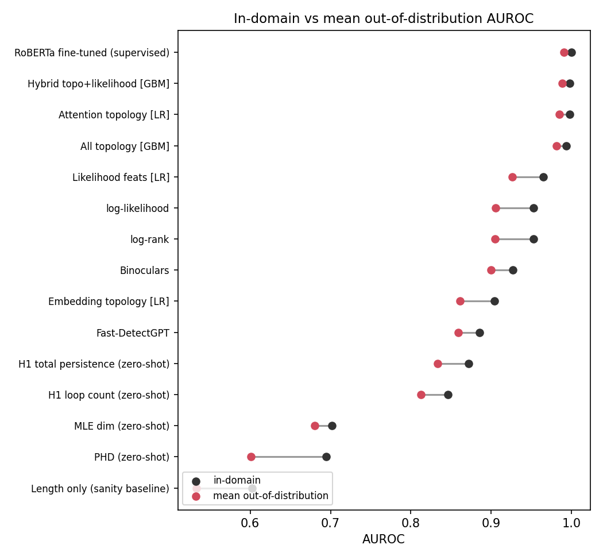
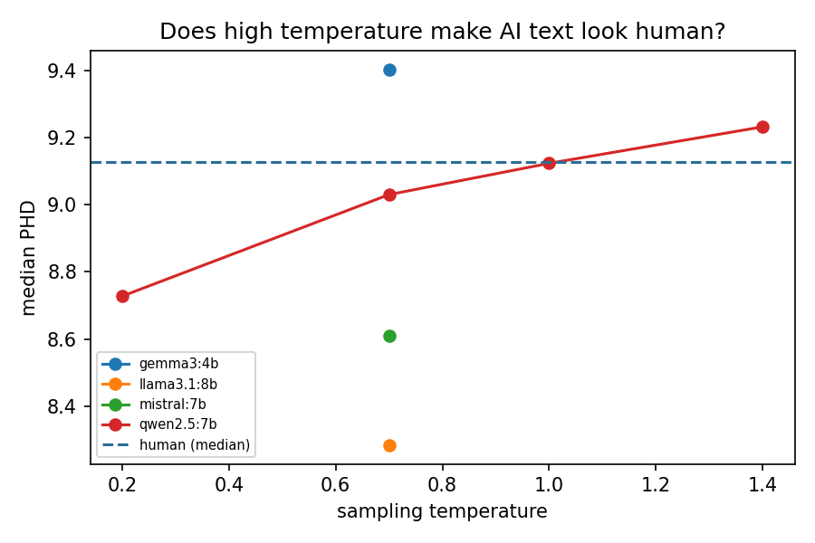

# Topological Detection of AI-Generated Text

**Question:** do topological signatures of transformer representations — the *intrinsic dimension* of a
text's token-embedding cloud and the *persistent homology* of its attention maps — still separate
human from machine text for **modern LLMs**, and do they hold up better than standard detectors when
the generator, domain, sampling temperature or wording changes?

This repo implements three families of topological detectors, strong non-topological baselines, and a
**robustness grid** that trains on one condition and tests on another. It runs end-to-end on a 6 GB
laptop GPU (RTX 4050).

> **Status:** complete through stage 2. 30 tests pass, including a full end-to-end run on an offline toy setup.
> Results below are from real runs on an RTX 4050 laptop (see `results/main_v2/`).

---

## Why topology?

| Signal | Idea | Reference |
|---|---|---|
| **PHD** — persistent-homology dimension of RoBERTa token embeddings | AI text occupies a *lower-dimensional* region of embedding space (≈1.5 dims lower than human text); zero-shot, reported robust across domains, generators and paraphrasing | Tulchinskii et al., NeurIPS 2023 |
| **Attention-map topology** — Betti numbers and H0 barcodes of 144 attention graphs | Machine text produces measurably different attention-graph structure | Kushnareva et al., EMNLP 2021 |
| **Embedding-cloud persistence** — H0/H1 barcode statistics, MLE/TwoNN dimension | Multi-scale shape of the token cloud beyond a single dimension number | Fractal Clouds (2025), this repo |

Open gaps this project targets (see `docs/MATH.md` for the maths):
1. Topological detectors were validated on GPT-2 / GPT-3.5-era text; a 2026 benchmark of AI-text detectors left them out entirely.
2. PHD's stated weaknesses — **high sampling temperature** and short texts — haven't been systematically mapped.
3. Attention topology and embedding PHD come from the same group but have **never been combined** with each other or with likelihood features.

## What's implemented

```
src/topodetect/
  persistence.py      H0 persistent homology from scratch: union-find (Kruskal), dense Prim,
                      batched Prim over 144 heads; diagram summaries, Betti curves
  phd.py              PHD estimator from scratch (MST scaling law) + MLE + TwoNN dimension
  features/cloud.py       PHD, MLE, TwoNN, H0/H1 barcode stats of the token-embedding cloud
  features/attention.py   Kushnareva-style attention topology (4320 features / text)
  features/perplexity.py  likelihood stats, Fast-DetectGPT (analytic), Binoculars
  encoders.py         HF wrappers (fp16, optional 4-bit) sized for a 6 GB GPU
  data.py             HC3 / RAID / MAGE / local-JSONL loaders into one schema
  splits.py           leak-free (grouped by prompt) robustness splits
  detectors.py        zero-shot + trained detectors (LR / gradient boosting, hybrid)
scripts/
  00_sanity_phd.py        PHD recovers known dimensions (circle, sphere, torus, cubes...)
  01_build_dataset.py     assemble data from the sources enabled in configs/default.yaml
  01b_generate_ollama.py  modern-LLM texts locally (Qwen2.5, Llama 3.1, Mistral, Gemma 3) + temperature sweep
  01c_paraphrase.py       adversarial rewrites (paraphrase / "humanize")
  01d_collect_frontier.py held-out frontier-model set (any OpenAI-compatible API, or manual CSV)
  02_extract_features.py  resumable, chunked feature extraction (GPU forward + CPU worker pool)
  03_run_grid.py          every detector x every split -> grid.csv + summary.md
  04_report.py            figures (AUROC heatmap, robustness gap, PHD by generator/temperature/attack)
  05_finetune_roberta.py  supervised RoBERTa baseline on the same splits
  06_confound_checks.py   per-length-quintile and per-domain AUROC of every zero-shot signal
app/demo.py               Gradio demo: paste text -> PHD, barcode, MST-scaling plot, hybrid score
docs/MATH.md              the maths, written for interview prep
```

**Robustness grid** (all splits grouped by prompt, so no question leaks across train/test):

| Split family | Train on | Test on |
|---|---|---|
| `in_domain` | 70% of prompts | other 30% |
| `loo_gen:<g>` | all generators except g | g (unseen model) |
| `loo_dom:<d>` | all domains except d | d (unseen domain) |
| `attack:<a>` | clean text | paraphrased / "humanized" text |
| `temp:<t>` | T = 0.7 | T = t (0.2 … 1.4) |
| `heldout:frontier` | everything else | frontier-model texts (GPT-5 / Gemini / Claude …) |

Metrics: AUROC, **TPR at 1% FPR** (the practical one — a detector that wrongly flags 5% of human
writers is unusable), accuracy and F1 at a threshold chosen on train.

---

## Setup (Windows, RTX 4050)

```powershell
cd D:\Projects\tda-ai-text-detection
python -m venv .venv
.venv\Scripts\activate
# CUDA PyTorch (skip if your environment already has it):
pip install torch --index-url https://download.pytorch.org/whl/cu124
pip install -r requirements.txt
python -m pytest -q                 # 24 tests, ~2-3 min (includes a full offline pipeline run)
python scripts\00_sanity_phd.py     # should print PHD ≈ true dimension for every shape
```

## Run it — stage 1: a first real result (one evening)

HC3 only (human vs ChatGPT, 5 domains, up to 6,000 texts):

```powershell
python scripts\01_build_dataset.py
python scripts\02_extract_features.py --limit 200        # smoke run first (~2 min)
python scripts\02_extract_features.py                    # full run; resumable if interrupted
python scripts\05_finetune_roberta.py --families in_domain loo_dom
python scripts\03_run_grid.py
python scripts\04_report.py
python scripts\06_confound_checks.py                    # is each signal just a proxy for length / domain?
```

Rough timings on a 4050 laptop (estimates — the script prints a live ETA): feature extraction
~30–60 min (CPU-bound topology; raise `features.workers` if you have more cores), grid ~10–20 min,
RoBERTa ~3–6 min per split.

## Stage 2: modern LLMs, temperature and attacks (run generation overnight)

```powershell
# install Ollama from ollama.com, then:
ollama pull qwen2.5:7b; ollama pull llama3.1:8b; ollama pull mistral:7b; ollama pull gemma3:4b
python scripts\01b_generate_ollama.py      # 300 questions x 7 (model, temperature) jobs ≈ 2,100 texts
python scripts\01c_paraphrase.py --n 600   # paraphrase + humanize attacks
```

Frontier held-out set (300–500 texts is plenty). Either paste answers from chat UIs into
`data/frontier/manual.csv` (template provided) and run
`python scripts\01d_collect_frontier.py csv data\frontier\manual.csv`, or use any OpenAI-compatible API:

```powershell
$env:FRONTIER_BASE_URL="https://generativelanguage.googleapis.com/v1beta/openai"
$env:FRONTIER_API_KEY="..."
python scripts\01d_collect_frontier.py api --models gemini-2.5-flash --per-domain 40
```

Then rebuild and re-run steps 01 → 04 (feature extraction skips nothing because the dataset changed —
delete `features\main` first, or set `dataset_name: main_v2` in the config).

Optional: set `data.raid.enabled: true` for RAID's 11 generators and 11 adversarial attacks (streams
from the HF hub; the first pass is slow).

## Stage 3: extensions (pick one or two)

- **Hybrid** (already in the grid): does topology + likelihood beat either alone, and on which splits?
- **Temperature**: plot `phd_vs_temperature.png` — at what T does AI text's PHD reach the human range?
- **Layer ablation**: PHD from layers 4 / 8 / 12 instead of only the last (edit `cloud_features` call).
- **Attention H1**: set `attn_h1: true` on a 1,000-text subset — are loops in attention graphs informative?
- **Boundary detection**: sliding-window PHD to locate where human text turns into AI text (RoFT dataset).

---

## Results

Dataset `main_v2`: **8,108 texts** (5,689 AI / 2,419 human) across 5 domains. The human and ChatGPT texts come
from HC3. The rest come from four local LLMs via Ollama (Qwen2.5-7B, Llama-3.1-8B, Mistral-7B, Gemma-3-4B), plus a
Qwen temperature sweep (T = 0.2 / 1.0 / 1.4) and 1,173 adversarial rewrites (paraphrase / "humanize") written by
Llama-3.1-8B. The grid has 17 leak-free splits × 14 detectors. In the attack splits the attacker model is excluded
from training. Full tables: `results/main_v2/summary.md`, `confounds.md`, `figures/`.

AUROC (TPR@1%FPR in the last column):

| Detector | In-domain | Mean OOD | T = 1.4 | Paraphrase | Humanize | Unseen Gemma | TPR@1%FPR |
|---|---|---|---|---|---|---|---|
| **Attention topology + LR** (frozen RoBERTa) | 0.998 | 0.984 | **0.991** | **0.996** | **0.953** | **0.992** | 0.965 |
| Hybrid topology + likelihood [GBM] | 0.997 | 0.986 | 0.986 | 0.990 | 0.949 | 0.972 | 0.940 |
| RoBERTa fine-tuned (supervised) | 1.000 | 0.986 | – | 1.000 | 0.948 | 0.995 | 0.996 |
| Likelihood features + LR | 0.965 | 0.915 | 0.913 | 0.859 | 0.833 | 0.818 | 0.691 |
| log-likelihood (zero-shot) | 0.952 | 0.892 | 0.880 | 0.851 | 0.785 | 0.791 | 0.625 |
| Binoculars (zero-shot, 0.5B pair) | 0.927 | 0.891 | 0.825 | 0.757 | 0.944 | 0.830 | 0.497 |
| Fast-DetectGPT (zero-shot, 0.5B) | 0.885 | 0.852 | 0.750 | 0.727 | 0.928 | 0.781 | 0.427 |
| H1 total persistence (zero-shot) | 0.872 | 0.827 | 0.802 | 0.800 | 0.786 | 0.778 | 0.190 |
| PHD (zero-shot, NeurIPS '23) | 0.695 | 0.579 | 0.497 | 0.445 | 0.493 | 0.465 | 0.026 |
| Length only (sanity baseline) | 0.602 | 0.523 | 0.484 | 0.471 | 0.491 | 0.566 | 0.000 |

Under the humanize attack, TPR@1%FPR is 0.625 for attention topology, 0.527 for fine-tuned RoBERTa, 0.511 for
the hybrid and 0.022 for log-likelihood.

<p align="center">
  
  
</p>

*Left: how much AUROC each detector loses off-distribution (unseen model, domain, temperature or attack).
Right: why PHD fails on modern models. Qwen's intrinsic dimension rises with sampling temperature and crosses the
human median at T = 1.0, and Gemma-3 sits above it even at T = 0.7.*

### Findings
1. **Attention-map topology + a linear probe matches full fine-tuning.** With frozen RoBERTa and 4,320
   interpretable features (Betti numbers and H0 barcodes of 144 attention graphs), mean out-of-distribution AUROC
   is 0.984 vs 0.986 for fine-tuned RoBERTa. It **beats** fine-tuning under the held-out-attacker "humanize" attack
   (TPR@1%FPR 0.625 vs 0.527). When the attacker was held out of training, fine-tuned RoBERTa dropped from 0.70
   to 0.53 TPR, so it had partly been recognising the attacker's style. Attention topology did not change (0.62 → 0.63).
2. **PHD (Tulchinskii et al., NeurIPS 2023) does not transfer to modern LLMs.** It replicates on 2022 ChatGPT
   (AUROC 0.81; human 9.13 vs AI 7.68 dims, gap 1.45 as in the paper) but falls to chance at T ≥ 1.0 (0.51 / 0.50)
   and below chance under LLM paraphrase (0.445). The paper reported robustness to DIPPER paraphrasing.
3. **H1 persistence of the token cloud is the most temperature-stable zero-shot signal.** It stays within 0.80–0.84
   AUROC from T = 0.2 to 1.4. Over the same range log-likelihood drops 0.054, Binoculars 0.113 and Fast-DetectGPT
   0.141. Log-likelihood stays higher in absolute terms, so H1 degrades least but is not the best. It survives
   length control (≥ 0.83 within every length quintile).
4. **Zero-shot detectors fail in complementary ways.** Paraphrase breaks Binoculars / Fast-DetectGPT (0.76 / 0.73);
   humanize breaks likelihood / H1 (≈ 0.79) but not Binoculars / Fast-DetectGPT (0.94 / 0.93).
5. **HC3 alone is saturated** (stage 1, `results/main`): most detectors score ≥ 0.99 on 2022 ChatGPT. Modern
   generators, sampling temperature and rewrites are what separate the detectors.

## Honest caveats (say these in interviews — they signal maturity)

- **No detector is universal.** Every method degrades under paraphrasing and on unseen generators;
  the contribution here is *measuring how much*, not a magic classifier.
- Fast-DetectGPT and Binoculars are run with **scaled-down scorer models** (Qwen2.5-0.5B) to fit 6 GB;
  the published versions use 2.7B–7B models, so their numbers here are lower bounds.
- HC3's human answers are from 2022–23 forums; domain/formatting artefacts can leak signal. Generation
  prompts ask for plain paragraphs and matched length to reduce this, and `loo_dom` splits expose it.
- Detectors are biased against non-native English writing (documented for commercial detectors);
  never use a single score to accuse a person.

## Resume lines

> **Topological Detection of AI-Generated Text** | PyTorch, Hugging Face, persistent homology, Ollama
> - Benchmarked 14 AI-text detectors (persistent homology, attention-graph topology, likelihood, Fast-DetectGPT,
>   Binoculars, fine-tuned RoBERTa) on 8.1k texts from 5 LLMs over a 17-split leak-free robustness grid
>   (unseen model / domain, sampling temperature 0.2–1.4, LLM paraphrase attacks with the attacker held out)
> - Topological features of 144 frozen-RoBERTa attention graphs + logistic regression matched full RoBERTa
>   fine-tuning off-distribution (AUROC 0.984 vs 0.986) and beat it under "humanize" attacks (62.5% vs 52.7%
>   TPR@1%FPR), where likelihood detectors fell to 2%
> - Showed the NeurIPS '23 intrinsic-dimension (PHD) detector replicates on ChatGPT (0.81 AUROC) but collapses to
>   chance on modern LLMs at T ≥ 1 and under paraphrase; implemented PHD and H0 persistence from scratch
>   (MST scaling law, union-find, batched Prim, 5.6× faster attention topology)

## References

- Kushnareva et al. *Artificial Text Detection via Examining the Topology of Attention Maps.* EMNLP 2021.
- Tulchinskii et al. *Intrinsic Dimension Estimation for Robust Detection of AI-Generated Texts.* NeurIPS 2023. (code: ArGintum/GPTID)
- Wei et al. *Short-PHD: Detecting Short LLM-generated Text with TDA After Off-topic Content Insertion.* COLM 2025.
- Kuznetsov et al. *Robust AI-Generated Text Detection by Restricted Embeddings.* 2024.
- Bao et al. *Fast-DetectGPT.* ICLR 2024. · Hans et al. *Binoculars.* ICML 2024.
- Guo et al. *HC3.* 2023 · Dugan et al. *RAID.* ACL 2024 · Li et al. *MAGE.* ACL 2024.
- Baidya et al. *Detecting the Machine: A Comprehensive Benchmark of AI-Generated Text Detectors.* 2026.
- Schweinhart. *Fractal dimension and the persistent homology of random geometric complexes.* 2020.
